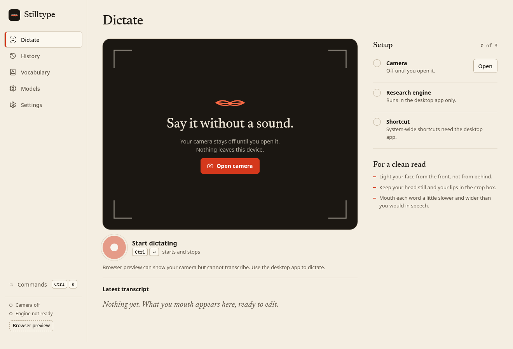
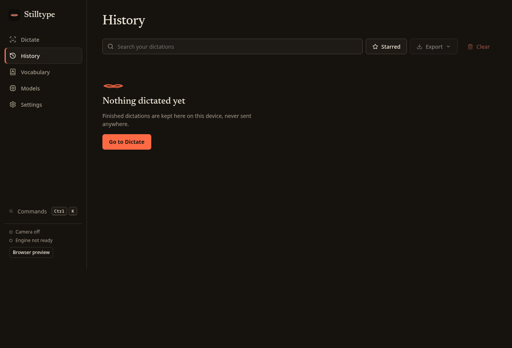
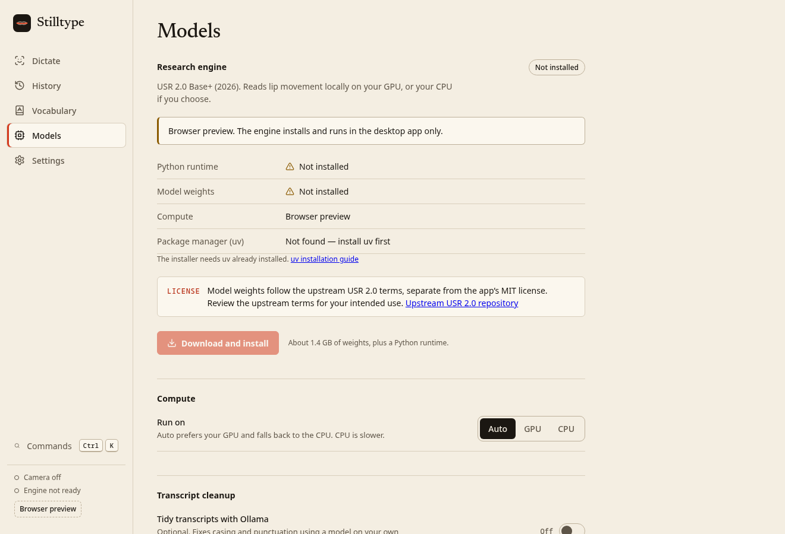

<p align="center">
  
</p>

<h1 align="center">Stilltype</h1>

<p align="center">Camera-only silent dictation for quiet rooms. Mouth it, read it, paste it — everything stays on your machine.</p>

<p align="center">
  <a href="docs/BUILDING.md">Building</a> ·
  <a href="CONTRIBUTING.md">Contributing</a> ·
  <a href="SECURITY.md">Security</a> ·
  <a href="THIRD_PARTY.md">Third-party notices</a>
</p>

---



*The Dictate page with no history yet — camera guidance, readiness and transcript in one place. Screenshots show the real empty application state, not model proof.*

|  |  |
| --- | --- |
| *Searchable history with favorites, before any dictations exist.* | *Model setup with explicit license consent and real readiness.* |

## What it is

Stilltype is a local-first, cross-platform dictation app that reads silently mouthed words from your camera — no microphone, no audio waveform, no cloud. The closed-mouth seam is the signature: point the camera at your face, mouth a sentence, and Stilltype turns it into editable text you can copy or paste.

- **Tauri 2 + Rust** own persistence, ephemeral capture files, the global shortcut, tray, clipboard/paste, and the private lifecycle of the Python recognition worker.
- **React + TypeScript** (Radix primitives) render the Dictate, History, Vocabulary, Models and Settings surfaces.
- **Local YuNet face tracking** extracts eye, nose and mouth landmarks using the published OpenCV Zoo YuNet 2026may ONNX export and onnxruntime-web WASM. JPEG frames and those landmarks stay local; the engine aligns and crops the mouth before recognition. The 2026 utility export shares learned weights with the earlier YuNet architecture; it is not newly trained face weights. Full provenance: [public/vision/NOTICE.md](public/vision/NOTICE.md).
- **USR 2.0 recognition (2026 release)**: the USR 2.0 Base+ high-resource checkpoint from [ahaliassos/usr2](https://github.com/ahaliassos/usr2) ([paper](https://arxiv.org/abs/2602.19316)). Recognition code is MIT; the pretrained checkpoint carries its own research/data rights — check upstream before your intended use (see [THIRD_PARTY.md](THIRD_PARTY.md)).
- **GPU preferred, CPU available.** Auto mode uses CUDA, then MPS, and falls back to CPU when no GPU is available; `settings.inferenceDevice` (`auto` | `gpu` | `cpu`) exposes explicit GPU-only and CPU modes.
- **Optional cleanup** via a local [Ollama](https://ollama.com) model at `http://127.0.0.1:11434` only — never a hosted service.

> **Platform status:** the Linux `.deb` builds and the native app launches. A real 8.28-second public video exercised recognition on CUDA (4.1 seconds) and CPU (20.9 seconds) at beam 5; this is a runtime smoke check, not an accuracy benchmark. The actual JavaScript/WASM face detector also found the face in that video. Windows/macOS execution and the complete webcam-to-paste workflow are not yet verified. The isolated browser test denied camera access, so no live webcam result is claimed.

## Features

| Area | What you get |
| --- | --- |
| Dictate | Camera stage with face-detector guidance (too dark, move closer, hold still), hold or toggle shortcut, elapsed time and clip limit |
| Inference device | Auto (CUDA → MPS → CPU fallback), explicit GPU-only, or CPU — via Settings |
| Beam size | Default 5, valid 1–60 — beam 30 exceeded the 6 GB GPU memory on the tested CUDA host |
| History | Editable, searchable dictations grouped by date; raw and cleaned text, favorites, copy and delete |
| Vocabulary | Case-insensitive word and phrase replacements, with canonical spelling and capitalization |
| Export | History export to TXT, JSON or CSV — actual history only, never sample data |
| Models | Explicit license consent, meaningful download/verify progress, real readiness state |
| Cleanup (optional) | Local Ollama pass that fixes look-alike-word swaps; off unless you enable it |
| Themes | Light, dark and system |
| Privacy controls | History on/off, retention window, camera preview preferences, no telemetry anywhere |

## Quickstart

Prerequisites: Node 20+, Rust stable, and `uv` on PATH for source installs (see [docs/BUILDING.md](docs/BUILDING.md) for platform packages).

```sh
npm ci
npm run dev       # labeled browser preview; native recognition unavailable
npm run desktop   # full Tauri app with camera, shortcut and local inference
```

Build installers on the host you ship for (no cross-compiled DMG/NSIS from Linux):

```sh
npm run desktop:build
# Linux Debian package only:
npm run tauri -- build --bundles deb
```

Install the recognition checkpoint from the app's **Models** page after installing `uv`, or from the command line:

```sh
python3 engine/install.py --models /path/to/models --accept-license
```

The installer fetches the USR 2.0 Base+ high-resource checkpoint (~1.39 GB) into `models/usr2/baseplus.pth`, verifies its SHA256, and writes `installed.json` as the runtime model marker. Weights are never in git. Inference needs Python 3.12 with `torch`, `numpy`, `opencv-headless` and `six` (see [engine/requirements.txt](engine/requirements.txt)). The worker protocol is private stdio:

```sh
python -u engine/worker.py --models /path/to/models
```

## Limitations, stated plainly

- **Experimental accuracy.** Lipreading is visually ambiguous (p/b/m, f/v, t/d/n look alike). Stilltype shows readiness honestly and makes no accuracy promises; there are no accuracy percentages anywhere in the app.
- **No microphone, no network recognition.** There is no HTTP inference service; if the camera or model is missing, the app says so instead of guessing.
- **Check the checkpoint's terms for your use.** The USR 2.0 code is MIT, but the pretrained checkpoint's research/data rights are separate — confirm they cover your intended use upstream before relying on them.
- **Local data is not encrypted.** History lives in the app-data directory for `com.stilltype.desktop`; retention controls delete old entries but the store itself is plaintext (see [SECURITY.md](SECURITY.md)).
- **Linux Wayland caveats.** Global shortcuts and simulated paste may be limited under Wayland; clipboard copy always works as a fallback.
- **Unsigned, no releases yet.** No signing certificates or notarization are set up, and there are no prebuilt releases — build from source for now.

## Contributing, security, licensing

- [CONTRIBUTING.md](CONTRIBUTING.md) — short guidance and the exact checks to run.
- [docs/BUILDING.md](docs/BUILDING.md) — prerequisites, per-OS dependencies, GPU/CPU notes, data paths and uninstall.
- [SECURITY.md](SECURITY.md) — what stays local, what is ephemeral, and how to report issues.
- [LICENSE](LICENSE) — app code is MIT, copyright 2026 Stilltype contributors.
- [THIRD_PARTY.md](THIRD_PARTY.md) — USR 2.0, ESPnet and model terms; weights are separately licensed and never relicensed by this project.
- Recognition: [USR 2.0 repository](https://github.com/ahaliassos/usr2) · [paper](https://arxiv.org/abs/2602.19316)
