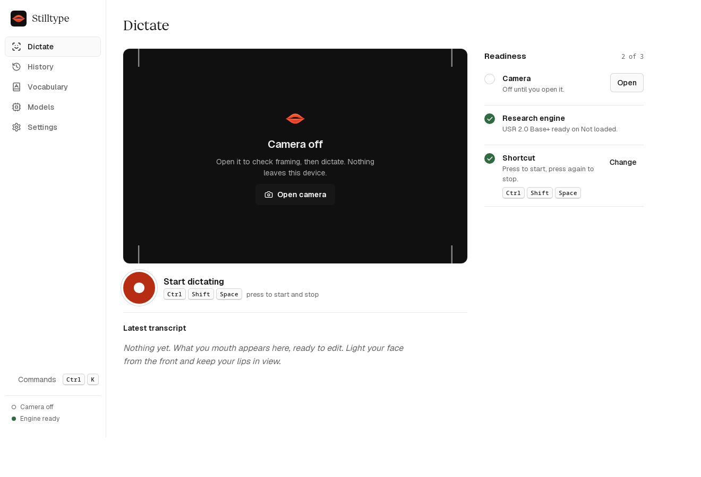
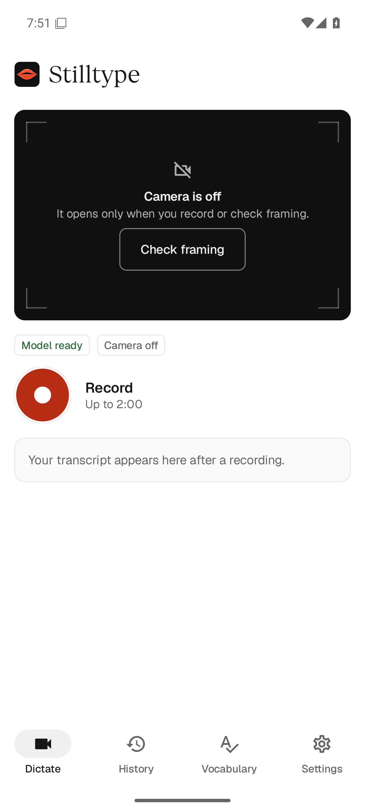
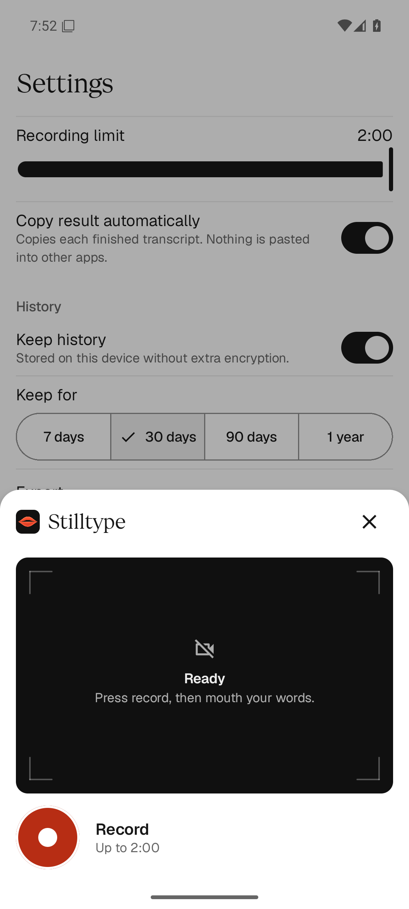
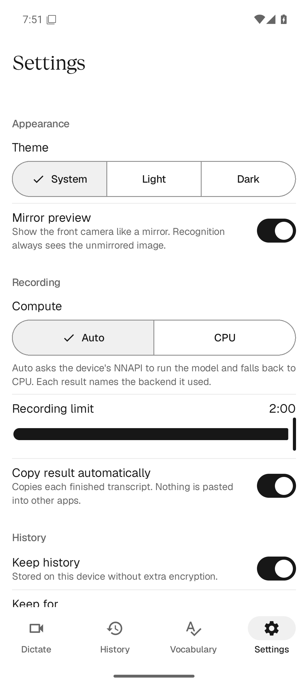
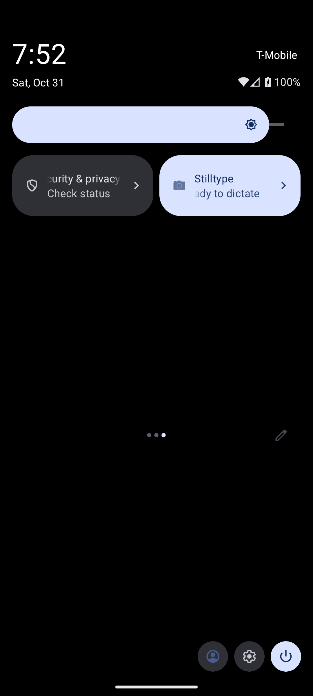
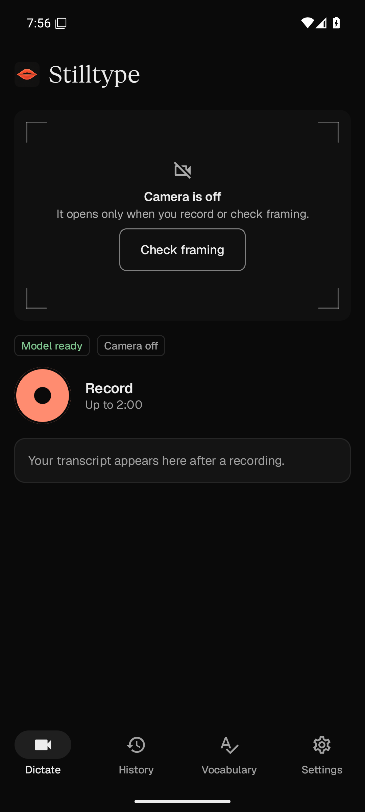
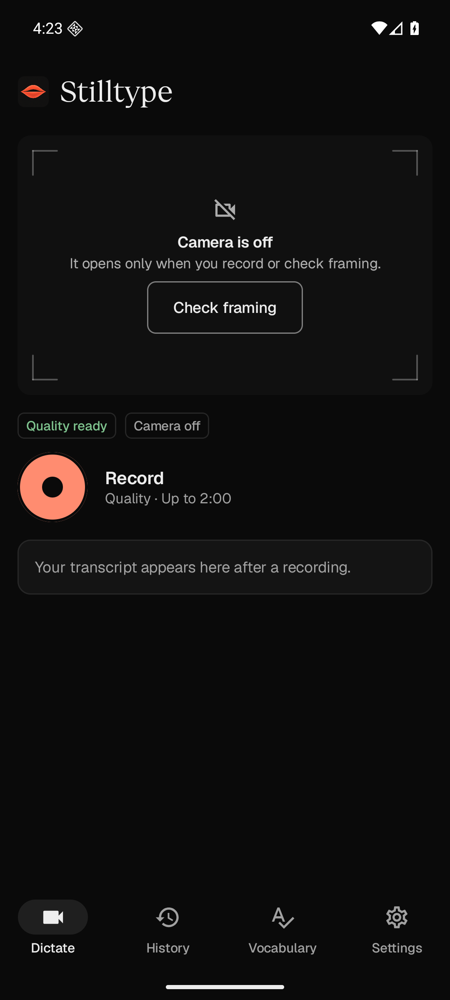
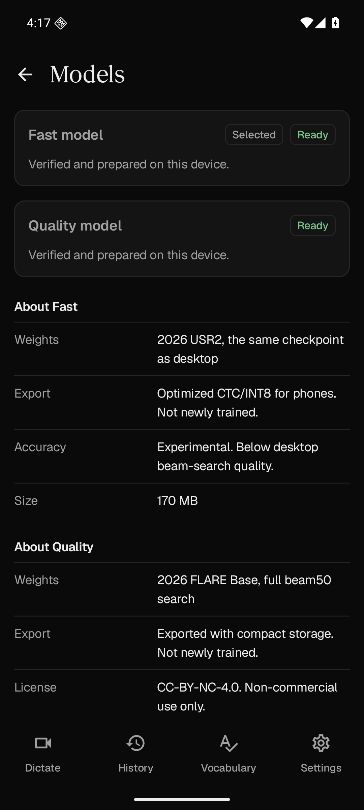
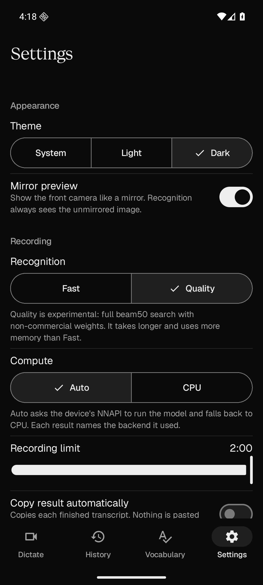
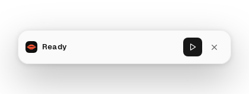

<p align="center">
  
</p>

<h1 align="center">Stilltype</h1>

<p align="center">Silent on-camera dictation that stays on your device.<br />Mouth it&ensp;·&ensp;read it&ensp;·&ensp;paste it.</p>

<p align="center">
  <a href="docs/BUILDING.md">Desktop build</a> ·
  <a href="docs/ANDROID.md">Android</a> ·
  <a href="CONTRIBUTING.md">Contributing</a> ·
  <a href="SECURITY.md">Security</a> ·
  <a href="THIRD_PARTY.md">Third-party notices</a>
</p>

---

<picture>
  <source media="(prefers-color-scheme: dark)" srcset="https://raw.githubusercontent.com/hffmnnj/stilltype/main/docs/screenshots/desktop-dark.png" />
  
</picture>

<p align="center"><sub>Dictate on desktop, light and dark. Screenshots show the real app UI — not a model accuracy claim.</sub></p>

Stilltype reads silently mouthed words from your camera and turns them into editable text. No microphone, no accounts, no hosted inference, no telemetry. The desktop app pairs a Tauri&nbsp;2 / Rust / React shell with a private Python stdio visual-inference worker and compiled-in text cleanup; the Android companion is native Kotlin&nbsp;/ Compose&nbsp;Material&nbsp;3 with ONNX&nbsp;Runtime and OpenCV — no Python on the phone.

<p align="center">
  
  &ensp;
  
  &ensp;
  
</p>

<p align="center"><sub>Android Dictate, compact capture, and Settings — real app states, shown at phone scale.</sub></p>

<details>
  <summary>Quick Settings shortcut and Android dark mode</summary>
  <p align="center">
    
    
  </p>
</details>

<details>
  <summary>Android Quality mode, model readiness, and matching controls</summary>
  <p align="center">
    
    
    
  </p>
  <p align="center"><sub>Real Android emulator captures. Quality is optional, memory-intensive, and not a physical-phone accuracy claim.</sub></p>
</details>

## What you get

- **Two-minute dictation.** Record up to two minutes on every platform, with camera guidance, elapsed time and a configurable limit. Bounded inference windows keep long recordings manageable instead of discarding everything after eight seconds.
- **Fast or Quality on Android.** Keep the lightweight default, or prepare the optional 2026 FLARE model for full beam-50 decoding and centered face/lip alignment. Quality needs an 8 GB-class device and separate non-commercial-model consent. It improves ordinary-speech video benchmarks at a higher time and memory cost; silent-mouthing accuracy remains experimental.
- **Native shortcut overlay.** A compact always-on-top capsule that follows dictation without pulling you out of your current app — opening, recording, processing, result and error states with Stop / Cancel / Dismiss plus Copy and Open where they apply.
- **Editable history.** Searchable, date-grouped dictations with raw and cleaned text, favorites, copy and delete. Nothing is ever seeded.
- **Vocabulary.** Case-insensitive word and phrase replacements with canonical spelling and capitalization.
- **Model consent and status.** Desktop model downloads and Android's bundled-model preparation require explicit consent and report real readiness.
- **Export and sharing.** History exports to TXT, JSON or CSV on desktop; local share and clipboard on Android. You deliberately share or copy every export.
- **Quiet controls.** Light, dark and system themes, retention window, inference-device selection (Auto / GPU / CPU), beam size, camera-preview preference — no telemetry anywhere.

```
camera → face + mouth alignment → visual recognition → text → optional local cleanup → copy / paste / export
```

Desktop cleanup defaults to punctuation and capitalization while preserving your wording. Optional **Intent** mode attempts bounded word corrections, but can be wrong and has not consistently improved held-out recognition. Both modes retain the raw text. There is no inference server to call.

## Quickstart

### Desktop

Prerequisites: Node 20+, Rust stable, `uv` on PATH. Per-OS packages and GPU notes live in [docs/BUILDING.md](docs/BUILDING.md).

```sh
npm ci
npm run desktop   # full Tauri app: camera, shortcut, local inference
```

Then open the **Models** page and consent to the recognition checkpoint: the pinned 2026 USR&nbsp;2 Base+ weights (~1.39&nbsp;GB), GPU (CUDA&nbsp;/ MPS) preferred with a real CPU mode. Optional cleanup uses compiled-in `llama.cpp` through `llama-cpp-2` 0.1.160 with separately consented 2026 Qwen3.5 Q4 models: 0.8B (~580&nbsp;MB), 2B (~1.40&nbsp;GB), or 4B (~3.01&nbsp;GB), with capacity-based Auto selection. Build an installer on the host you ship for with `npm run desktop:build`.

### Android

The full flow, including the phone-model export, is in [docs/ANDROID.md](docs/ANDROID.md).

```sh
cd android
./gradlew :app:assembleDebug -PmobileModelDir=/absolute/path/to/export
```

The Fast export derives a CTC-only mobile graph (~170&nbsp;MB INT8) from the same 2026 weights. Optional Quality adds a separate ~338&nbsp;MB FLARE pack with `-PqualityModelDir=/absolute/path/to/quality-pack`; [preparation, terms and memory requirements](docs/ANDROID.md#optional-quality-pack). Weights are never committed to git. Missing build properties honestly report the corresponding pack as not bundled. A Quick&nbsp;Settings tile and a pinned Dictate shortcut open a small visible capture activity — no Accessibility or overlay permission, no background camera. The manifest requests camera only: no microphone, and no Internet permission.

## Tested status

| Platform | State |
| --- | --- |
| Linux desktop | Builds, launches, and transcribes — an 8.28&nbsp;s public clip decoded at beam&nbsp;5 in 4.117&nbsp;s (CUDA) and 20.904&nbsp;s (CPU). Runtime smoke only, not an accuracy benchmark. Compiled-in cleanup returned identical punctuation on CPU and Vulkan. |
| Android | Native APK builds and runs. Fast and optional Quality both complete the 3,001-frame / two-minute recognizer journey. Quality also passes independent raw-reference, quiet-veto, CPU/Auto and cancellation checks on an 8&nbsp;GiB API&nbsp;36 emulator. **Not physical-phone speed or accuracy.** [Timings, memory limits and reproducible checks](docs/ANDROID.md). |
| macOS / Windows | Native-host execution still needed. macOS Fn is hold-to-dictate and may need Input&nbsp;Monitoring (restart after granting); most Windows&nbsp;/ Linux firmware reserves Fn, so Ctrl&nbsp;/ Cmd+Shift+Space is the fallback. Wayland may further limit global shortcuts, paste and overlay position — clipboard copy always works. |



Desktop beam-search quality does not transfer to Fast's CTC-only mobile decoding. Quality uses a different research model and centered alignment; its measured gains and remaining failures are [disclosed separately](docs/RECOGNITION.md#two-additional-speakers), not advertised as 90% product accuracy or phone speed. History is local plaintext; retention controls prune it but do not encrypt it.

**Genuine silent mouthing remains a major limitation.** A separate one-speaker development comparison found 69.57% WER even with the best experimental 7B visual model, which is not the APK engine. Ordinary spoken-video gains do not establish silent-dictation accuracy. [Source, all model results and limitations](docs/RECOGNITION.md#genuine-silent-mouthing-diagnostic).

The complete two-minute path was exercised too: 3,001 frames through the real
desktop recognizer and the Android recognizer, plus an actual Android camera
session that stopped at 2:00. The model tests repeat public-video crops;
they establish execution, not natural-speech accuracy.

## Docs and rights

- [docs/BUILDING.md](docs/BUILDING.md) — desktop prerequisites, GPU/CPU, data paths, uninstall.
- [docs/ANDROID.md](docs/ANDROID.md) — phone export, build variants, permissions, benchmark.
- [docs/RECOGNITION.md](docs/RECOGNITION.md) — raw word-error measurement, fixed evaluation sets and accuracy limits.
- [SECURITY.md](SECURITY.md) — what stays local, what is ephemeral, how to report issues.
- Recognition: [USR&nbsp;2.0 repository](https://github.com/ahaliassos/usr2) · [paper](https://arxiv.org/abs/2602.19316). Code is MIT; the pretrained checkpoint carries separate research&nbsp;/ data rights — check upstream before your intended use (see [THIRD_PARTY.md](THIRD_PARTY.md)).
- Optional Android Quality: [FLARE checkpoints](https://huggingface.co/Anony94/FLARE-checkpoints), **CC-BY-NC-4.0**. The app's MIT license does not remove the model's non-commercial restriction.
- App code is MIT ([LICENSE](LICENSE)). No signing, no public prebuilt releases yet — build from source for now.
